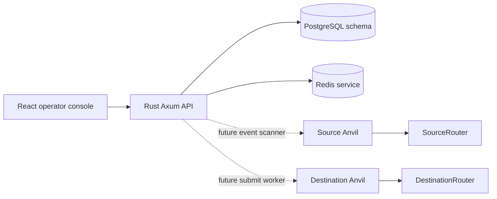

# RouterPulse

**A local-first cross-chain router and relayer operations console** built with Solidity, Foundry, Rust/Axum, React, PostgreSQL, Redis, and Docker Compose.

> Portfolio engineering project. The current release is an early foundation, not an audited bridge or production-ready relayer. It does not provide trustless verification, guaranteed delivery, or mainnet execution.

## What works in this foundation

- Source router with sender and destination allowlists, bounded payloads, expiry, nonces, deterministic message IDs, and message commitments.
- Destination router with trusted-source configuration, EIP-712 domain separation, a permissioned relayer signature, expiry checks, replay protection, pause control, and receiver callback execution.
- Relayer registry for owner-configured operators and destination permissions.
- Rust/Axum operator API with health endpoints, API-key boundary, chain metadata, and idempotent in-memory message registration.
- React operations console with localnet warning, overview metrics, throughput chart, route status, message search, and review timeline.
- PostgreSQL schema foundation, Redis, two local Anvil services, container builds, and local deployment scripts.

## Not implemented yet

The current API does not yet use PostgreSQL or Redis. There is no Alloy scanner, confirmation watcher, reorg reconciliation, worker lease, durable retry policy, or destination transaction submission worker. The dashboard contains clearly labeled demo metrics when the API has no messages. The API's in-memory records reset when the container restarts. Do not interpret sample route health or throughput as live chain telemetry.

## Architecture



The initial proof model trusts a single configured relayer signer. A valid signature only proves that the configured signer approved a message; it is not a trustless cross-chain proof.

## Quick start

Prerequisites: Docker Compose v2, Foundry (`forge` and `cast`).

```bash
./scripts/setup.sh
./scripts/up.sh
```

The startup script creates `.env` if needed, starts both Anvil chains, PostgreSQL, Redis, the API, and the web console, then deploys the router contracts to both local chains. It uses only deterministic, publicly known Anvil test keys. Never reuse them on a real network.

Open:

- Console: <http://localhost:3000>
- API readiness: <http://localhost:8080/readyz>
- Source JSON-RPC: <http://localhost:8545> (chain `31337`)
- Destination JSON-RPC: <http://localhost:8546> (chain `31338`)

The local operator API key is `local-demo-key-change-me`. Change it in `.env` before exposing the API beyond your machine. Connect it in the console using the key icon in the bottom-right corner.

Stop services with `./scripts/down.sh`. To remove local database and Redis data too, use `docker compose down -v`.

## API

Operator routes require the `x-api-key` header. Health checks are public.

| Method | Route | Purpose |
|---|---|---|
| GET | `/livez` | Process liveness |
| GET | `/readyz` | API readiness |
| GET | `/api/v1/chains` | Local chain metadata |
| GET | `/api/v1/messages` | List in-memory message records |
| GET | `/api/v1/messages/{id}` | Read one message |
| POST | `/api/v1/messages` | Idempotently register a message record |

Example:

```bash
curl -H 'x-api-key: local-demo-key-change-me' http://localhost:8080/api/v1/chains
```

The current message registration API is a learning scaffold, not a chain event ingestion endpoint. Mutations do not currently submit transactions.

## Repository map

```text
contracts/       Solidity routers, registry, Foundry config, local deploy script
backend/         Axum API and PostgreSQL schema foundation
frontend/        React/Vite operator console and Nginx config
scripts/         Local setup, startup, shutdown, deployment, smoke, and build commands
docs/            Architecture, API, security, operations, and implementation roadmap
compose.yaml     Two Anvil chains, PostgreSQL, Redis, API, and web console
```

## Development commands

```bash
./scripts/check.sh        # Solidity build/format, Rust lint/build, frontend build
./scripts/smoke.sh        # API health and authentication boundary
```

## Implementation roadmap

1. **Foundation (current):** repository layout, local chains, basic contracts, API boundary, UI, and container wiring.
2. **Contract hardening:** comprehensive unit/fuzz/invariant suite, signer rotation, domain and message-ID verification, and review of value/callback semantics.
3. **Durable domain:** SQLx repositories, transactional state transitions, immutable audit history, and migrations.
4. **Relayer:** Alloy event scanner, confirmation gates, source block-hash rechecks, reorg handling, Redis leases, safe simulation/submission, and receipt reconciliation.
5. **Operator product:** real API data, route configuration, evidence view, and explicit submit/retry/reconcile workflows.
6. **Operations:** metrics, dashboards, structured logs, backups, hardened images, integration checks, CI artifacts, and documentation screenshots.

See [docs/ARCHITECTURE.md](docs/ARCHITECTURE.md), [docs/SECURITY.md](docs/SECURITY.md), and [docs/ROADMAP.md](docs/ROADMAP.md) for detail.

## Security and limitations

- Permissioned relayer signature: trusted signer can approve false messages.
- RPC observations can be delayed, inconsistent, censored, or unavailable.
- Confirmation depth reduces but cannot remove reorg risk.
- Redis coordination is not authorization, and database records are not proof of finality.
- Destination callback failures revert execution; review gas, value, and callback policy before any extension.
- Local Anvil keys and credentials are development-only.
- There has been no independent security audit.

See [SECURITY.md](SECURITY.md) for reporting and [docs/SECURITY.md](docs/SECURITY.md) for the threat model.

## License

MIT. See [LICENSE](LICENSE).

